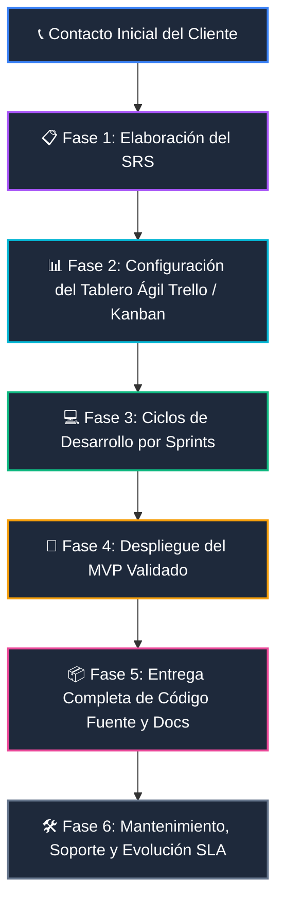

# 📋 Metodología Senior: Ciclo de Vida, SRS y Gestión de Entregables al Cliente

Esta guía establece el protocolo profesional de ingeniería y análisis de sistemas para gestionar proyectos de software de principio a fin, garantizando cero ambigüedades, transparencia total con el cliente mediante metodologías ágiles (Scrum/Kanban), desarrollo incremental por sprints y transferencia completa de propiedad del código fuente.

---

## 🏛️ Flujo Maestro de Entrega al Cliente



---

## 📑 Fase 1: El Documento SRS (Especificación de Requisitos de Software)

El **SRS** (*Software Requirements Specification*) es el contrato técnico y plano arquitectónico de la aplicación. **Antes de tirar una sola línea de código**, todos los requisitos deben estar capturados y validados para erradicar sorpresas o cambios no planificados (*scope creep*).

### Capas Esenciales de un SRS Profesional (Estándar IEEE 830 / ISO 29148):

```
                                  ESTRUCTURA DE UN SRS SENIOR
                                               │
     ┌──────────────────────┬──────────────────┴──────────────────┬──────────────────────┐
     ▼                      ▼                                     ▼                      ▼
【 1. DOMINIO & ALCANCE 】 【 2. MODELO DE NEGOCIO 】          【 3. REQUISITOS (RF/RNF) 】 【 4. DIAGRAMAS 】
• Introducción al problema • Objetivos de negocio                • Requisitos Funcionales   • Casos de Uso (UML)
• Límites del sistema      • Procesos de negocio (BPMN)          • No Funcionales (Seguridad,• Arquitectura C4
• Usuarios y Personas      • Criterios de éxito y KPIs           Rendimiento, Latencia)    • Modelo Entidad-Relación
```

#### Plantilla de Requisitos Funcionales vs. No Funcionales:
* **Requisito Funcional (RF):** *«El sistema debe permitir al administrador exportar el reporte de facturación en formato PDF y CSV con un rango de fechas filtrable.»*
* **Requisito No Funcional (RNF):** *«La exportación del reporte no debe tomar más de 1.5 segundos para conjuntos de datos de hasta 50,000 registros y debe requerir autenticación MFA.»*

> [!TIP]
> **Regla de Oro:** Si un requisito tiene más de una interpretación posible, es ambiguo. Dedica todo el tiempo necesario en la fase de análisis: 1 hora de análisis ahorra 20 horas de refactorización y discusiones con el cliente.

---

## 📊 Fase 2: Gestión Ágil y Transparencia (Scrum + Kanban)

El cliente debe tener visibilidad en tiempo real del estado de su proyecto mediante una herramienta colaborativa (Trello, Jira o Linear).

### Columnas Obligatorias del Tablero:
1. 📥 **Product Backlog:** Lista priorizada de todas las historias de usuario y tareas pendientes acordadas en el SRS.
2. 🏃 **Sprint Backlog (En este Sprint):** Tareas comprometidas para el ciclo actual (sprint de 1 a 2 semanas).
3. ⚙️ **En Progreso (WIP Limit):** Máximo 2-3 tareas activas simultáneamente para evitar cuellos de botella.
4. 🧪 **Code Review & Testing (QA):** Tarea terminada por desarrollo que está siendo probada en entorno de Staging.
5. ✅ **Terminado (Done):** Tarea validada y lista para la demo/entregable del sprint.

---

## 💻 Fase 3: Desarrollo Disciplinado por Sprints

* **Ciclos Cortos y Entregables:** Cada sprint finaliza con un **entregable funcional tangible** (un endpoint probado, una vista interactiva, un flujo de autenticación funcionando), no promesas en papel.
* **Demostración al Cliente (Sprint Review):** Al terminar el sprint, se realiza una sesión corta de demostración con el cliente para validar el avance y ajustar prioridades para el siguiente ciclo.

---

## 🚀 Fase 4: MVP (Mínimo Producto Viable)

Un MVP no es un producto roto o incompleto; es **la versión más simple y robusta del software que resuelve el problema central del negocio del cliente**.

```
    ❌ FORMA INCORRECTA (Por partes aisladas e inútiles):
    [ Rueda ] ➔ [ Chasis ] ➔ [ Carrocería ] ➔ [ Auto Completo 🚗 ]
    (El cliente no puede usar nada hasta el final)

    ✅ FORMA CORRECTA MVP (Valor incremental desde el día 1):
    [ Patineta 🛹 ] ➔ [ Bicicleta 🚲 ] ➔ [ Motocicleta 🏍️ ] ➔ [ Auto 🚗 ]
    (El cliente siempre tiene transporte funcional que evoluciona)
```

---

## 📦 Fase 5: Entrega Completa y Soberanía del Código Fuente

Un desarrollador o consultor Senior no "secuestra" el código del cliente. La entrega final debe incluir:

1. 💻 **Repositorio de Código Fuente:** Acceso total como administrador al repositorio Git limpio, estructurado y con historial de commits atómicos.
2. 🐳 **Infraestructura como Código:** Archivos `Dockerfile`, `docker-compose.yml` o scripts de despliegue para levantar el proyecto con un solo comando (`docker compose up`).
3. 📖 **Manual de Despliegue (`README.md`):** Variables de entorno documentadas (`.env.example`), pasos de instalación y arquitectura técnica.
4. 🗄️ **Base de Datos:** Scripts de migración y seeders (`seeds.sql`) para inicializar el esquema sin depender de datos manuales.

---

## 🛠️ Fase 6: Mantenimiento, Soporte y Contratos de Nivel de Servicio (SLA)

Una vez desplegada la aplicación en producción, se inicia la etapa de soporte continuo:

| Tipo de Soporte | Alcance | Frecuencia / SLA |
| :--- | :--- | :--- |
| **Soporte Correctivo (Bugs)** | Resolución de fallos críticos, caídas de servidor o errores no detectados en QA. | SLA Inmediato (2 - 4 horas). |
| **Soporte Preventivo** | Actualización de dependencias de seguridad, parches de SO y optimización de índices de BD. | Mensual / Trimestral. |
| **Soporte Evolutivo (Nuevas Features)** | Desarrollo de nuevos módulos que no estaban en el SRS original. | Cotizado como nuevo Sprint. |

---

*Este documento forma parte de la Guía del Ingeniero del workspace como manual metodológico de entrega y gestión de clientes.*
